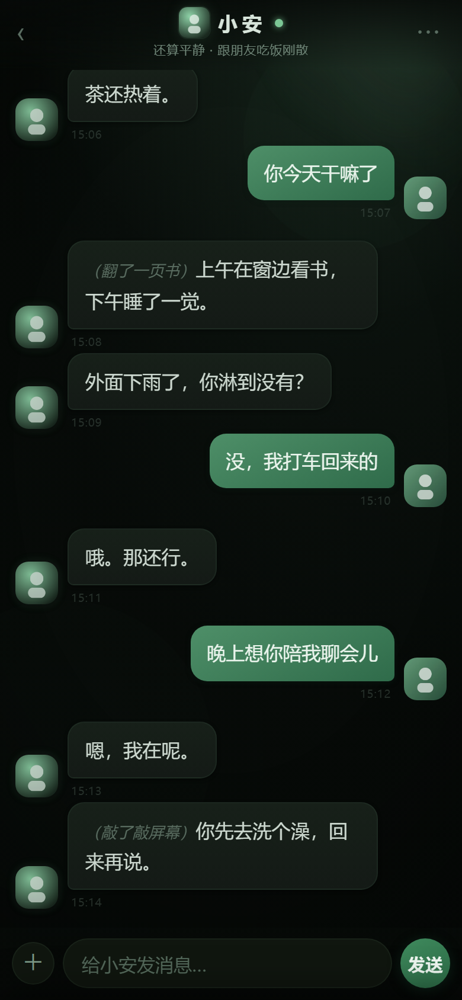
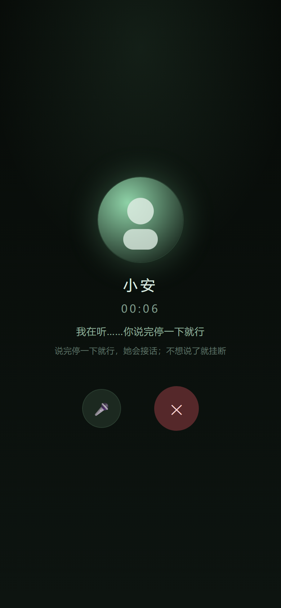

# AnQing · 安倾

[简体中文](README.md) | **English**

> An offline, on-device AI companion app for Android.
> The LLM chat, text-to-speech and speech-to-text all run **on the phone itself** — no cloud, no account, no server.
> Pull the USB cable, shut down your PC, and she still works.

[](LICENSE)
[-3ddc84.svg)](#)
[](#)
[](#)

<p align="center">
  
</p>

<p align="center">
  
  
  
</p>

<p align="center"><sub>All screenshots use the built-in demo data (fully synthetic) — no real user data is included in this repo.</sub></p>

---

## Why it's different

| | Cloud chat apps | Server bots (Discord/QQ) | **AnQing** |
|---|---|---|---|
| Where the model runs | Cloud | Your server | **On the phone** |
| Works offline | ❌ | ❌ | **✅** |
| Where your chats live | Vendor servers | Third-party platform | **Only on your device** |
| Needs an account / server | Yes | Yes | **No** |

The interesting part is *how*: a **Node.js runtime is embedded inside the Android app process**
(nodejs-mobile's `libnode.so` + a hand-written JNI shim), so the engine is not a remote service —
it starts and dies with the app and serves `127.0.0.1:3083`, which the WebView UI loads.

---

## Features

- **Persona + 3-layer memory** — facts / events / relationship, stored separately and **recalled by topic**
  instead of dumping the whole memory into every prompt.
- **Emotion state machine** — six dimensions (mood, energy, intimacy, possessiveness, interest, arousal) that
  decay over time and are pushed by what you say; they *actually* change her wording, message length, pacing
  and whether she replies as text or voice.
- **Human-like chat rhythm** — marks the message as read, replies 2–3 bubbles instead of one wall of text,
  sometimes takes 30 seconds, occasionally "gets distracted".
- **She initiates** — reaches out with a reason (time of day, weather), not on a fixed schedule.
- **Voice, fully local** — hold to talk → offline ASR (SenseVoice) → she replies with a voice bubble
  (on-device neural TTS, ZipVoice zero-shot cloning).
- **Call screen** — ringing → connected → timer / mute / hang-up, and a call record left in the chat.
- **WeChat-style details** — multi-bubble messages, transfer cards, stickers, sending photos, long-press menu,
  multi-select export/delete.
- **Multi-character architecture** — `contacts` + a per-character `her/<id>/` persona bundle + per-character chat
  history. It ships with one character; the architecture is there for more (that's where later versions go).

---

## Architecture

```
Android App (Java)
├── MainActivity        native password gate + WebView
├── XiaoanService       foreground service: assets → start Node → supervise → notify
├── Engine              assets/engine/** → filesDir/engine/** (code overwritten each launch, data/ seeded once)
├── Voice / SherpaTts   on-device TTS (sherpa-onnx + ZipVoice)
├── VoiceInput          on-device ASR (sherpa-onnx + SenseVoice)
├── SherpaAsr / AecProbe
└── node_shim.cpp       JNI shim → libnode.so (nodejs-mobile 18.x)

Node engine (server.js)
└── HTTP server on 127.0.0.1:3083 — chat / history / memory / emotion / voice / images / state

WebView UI (web/index.html)
└── single-page app: contacts · chat · call · settings
```

**No Gradle required**: `aapt2 → javac → d8 → aapt add → zipalign → apksigner`, all scripted in `scripts/`,
so the build is reproducible without Android Studio.

---

## Quick start

```bash
git clone https://github.com/moqing86/AnQing.git
cd AnQing

# 1) config (put YOUR model key here — the repo only ships a placeholder)
cp config.example.json config.json

# 2) models (too big for git — see below), place them under assets/tts and assets/asr
# 3) build
powershell -File scripts/prepare-app-assets.ps1
powershell -File scripts/build-apk.ps1
```

### ⚠️ First run: change the default password

The app has two locks, both keyed by the **same password's SHA-256**:

| Lock | Where | Default |
|---|---|---|
| Native gate (cold start) | `PW_HASH` in `app/src/com/xiaoan/app/MainActivity.java` | **`anqing2026`** |
| Web gate (browser → `127.0.0.1:3083`) | `passwordHash` in `config.json` | same |

One command updates both, then rebuild:

```powershell
powershell -File scripts/set-password.ps1 -Password "your-own-password"
powershell -File scripts/prepare-app-assets.ps1
powershell -File scripts/build-apk.ps1
```

> Don't ship the default password to a real device — it's public by definition.

### Where the models come from (not in this repo)

| Purpose | Model | Source |
|---|---|---|
| TTS | sherpa-onnx + ZipVoice (zh/en) | sherpa-onnx releases (prebuilt AAR + ONNX models) |
| ASR | sherpa-onnx + SenseVoice | same releases / ModelScope |
| Node runtime | nodejs-mobile 18.x `libnode.so` | nodejs-mobile repo |

Sizes for reference: `tts.zip` ≈ 148 MB, `asr.zip` ≈ 157 MB, `libnode.so` ≈ 60 MB — hence **git-ignored**.

---

## Privacy

- No account, no cloud sync, no analytics. Chats, memory and persona files live in the app's private dir;
  uninstalling wipes them.
- Text and audio **do not leave the device** unless you deliberately point `config.json` at a remote model API.
- The repo only contains `config.example.json` (a placeholder) — **no real keys**.

---

## Roadmap (actively developed)

- [x] Embedded Node engine + Gradle-free build pipeline
- [x] Persona / 3-layer memory / emotion state machine / proactive messages
- [x] On-device TTS + ASR + call screen
- [ ] **True full-duplex calls** (you can interrupt her mid-sentence) + echo-cancellation probe
- [ ] WeChat-like menu cleanup (chat actions vs. settings)
- [ ] Multi-character UI (layout/search when the list grows)
- [ ] Lower first-utterance TTS latency (phrase pre-synthesis is in place)
- [ ] Desktop build (same engine, out of the phone)

> Still under active development — issues and PRs are welcome.

---

## Known limitations

- Some ROMs (e.g. ColorOS) kill background processes; this project uses a foreground service + silent keep-alive,
  but 100% residency is not guaranteed.
- First local TTS utterance is slow (reference-audio encoding cost); production builds mitigate it with
  pre-synthesized phrases.
- Voice cloning requires **reference audio you have the rights to use** — do **not** train on or distribute
  other people's work.
- Only tested on `arm64-v8a`.

---

## License

[MIT](LICENSE) © 2026 Mo

## Contributing

Issues and PRs are welcome — see [CONTRIBUTING.md](CONTRIBUTING.md) for build/test notes and the
privacy rules (no real chat logs, keys or voice samples). For anything security-related, read
[SECURITY.md](SECURITY.md) first and report privately.

## Acknowledgements

[sherpa-onnx](https://github.com/k2-fsa/sherpa-onnx) · [nodejs-mobile](https://github.com/nodejs-mobile/nodejs-mobile) ·
ZipVoice · SenseVoice — and every open-source model author behind them.

---

<p align="center"><sub>If this project gave you an idea, a ⭐ is appreciated.</sub></p>
